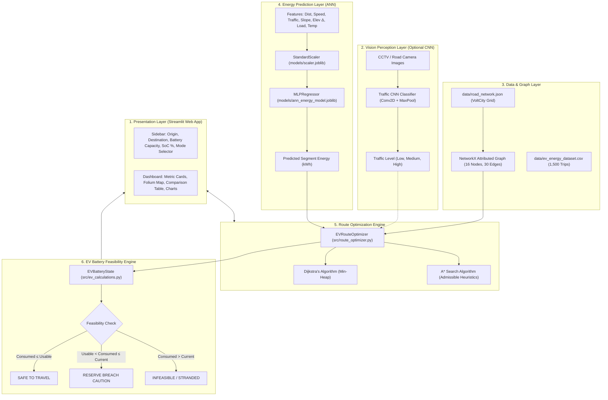

# Route Optimization System (Smart Navigation for Electric Vehicles)

> **Undergraduate College AI/ML Capstone Project**  
> **Domain:** Artificial Intelligence, Machine Learning, Graph Theory & Electric Vehicle (EV) Telematics  
> **Location:** `D:\UNIVERSITY RESOURCE\AI\PROJECT TESTING`

---

## Table of Contents
1. [Project Title](#1-project-title)
2. [Abstract](#2-abstract)
3. [Introduction](#3-introduction)
4. [Problem Statement](#4-problem-statement)
5. [Objectives](#5-objectives)
6. [Existing System vs. Proposed System](#6-existing-system-vs-proposed-system)
7. [Technologies Used](#7-technologies-used)
8. [System Architecture](#8-system-architecture)
9. [Dataset Description](#9-dataset-description)
10. [City Graph Representation (VoltCity)](#10-city-graph-representation-voltcity)
11. [ANN Model Explanation (Energy Prediction)](#11-ann-model-explanation-energy-prediction)
12. [CNN Extension Explanation (Traffic Vision)](#12-cnn-extension-explanation-traffic-vision)
13. [Dijkstra and A* Search Algorithms](#13-dijkstra-and-a-search-algorithms)
14. [Energy-Based Route Optimization Methodology](#14-energy-based-route-optimization-methodology)
15. [EV Battery Calculations & Feasibility Engine](#15-ev-battery-calculations--feasibility-engine)
16. [System Workflow](#16-system-workflow)
17. [Installation Instructions](#17-installation-instructions)
18. [How to Run the Project](#18-how-to-run-the-project)
19. [Sample Outputs & Experimental Results](#19-sample-outputs--experimental-results)
20. [Limitations](#20-limitations)
21. [Future Enhancements](#21-future-enhancements)
22. [Conclusion](#22-conclusion)
23. [List of Important Python Functions](#23-list-of-important-python-functions)
24. [15 Viva Questions & Simple Answers](#24-15-viva-questions--simple-answers)

---

## 1. Project Title
**Route Optimization System (Smart Navigation for Electric Vehicles)**  
*An AI-driven, topography-aware, and battery-constrained navigation engine combining Artificial Neural Networks, Graph Search Algorithms, and Interactive Mapping.*

---

## 2. Abstract
Electric Vehicles (EVs) are rapidly replacing internal combustion engine vehicles to reduce global carbon emissions. However, widespread adoption faces significant challenges, primarily **range anxiety**—the driver's fear of the battery running out before reaching a charging facility. Traditional satellite navigation applications (e.g., standard Google Maps) plan routes based solely on the shortest geographical distance or the fastest travel time. These algorithms overlook EV-specific physical constraints: gravitational energy lost while climbing steep hills, kinetic energy recovered through **regenerative braking** during descents, auxiliary heating/air conditioning (HVAC) drain during heavy traffic idling, and battery safety reserves.

This project introduces a **Smart EV Navigation and Route Optimization System**. An urban road grid is modeled as an attributed graph using **NetworkX**. A physics-grounded **Artificial Neural Network (ANN - MLPRegressor)** predicts segment-by-segment battery energy consumption in kilowatt-hours (kWh) with **98.59% accuracy ($R^2 = 0.9859$)**. Route planning is implemented via **Dijkstra's** and **A\* Search** algorithms supporting four navigation modes: *Shortest*, *Fastest*, *Energy-Efficient*, and *Balanced*. A comprehensive **Battery Feasibility Engine** calculates post-trip State of Charge (SoC), validates safety reserve buffers, issues warnings for unreachable journeys, and computes exact required en-route charging kilowatt-hours. The entire solution is delivered through a modern, reactive **Streamlit** dashboard featuring interactive **Folium** maps.

---

## 3. Introduction
Electric vehicles consume and replenish energy in ways fundamentally different from gasoline-powered vehicles:
1. **Regenerative Braking**: When an EV travels downhill or decelerates, the electric motor reverses into a generator, capturing kinetic energy and pumping electrical charge back into the battery pack.
2. **Topographical Gradients**: Driving uphill requires substantial mechanical work against gravity ($W = m \cdot g \cdot \Delta h$), rapidly exhausting battery range.
3. **Traffic Dynamics**: While internal combustion engines burn fuel continuously while idling, EVs consume minimal idle traction power but continue drawing auxiliary energy for climate control (heating and air conditioning), displays, and computer sensors.
4. **Aerodynamic Drag**: Aerodynamic resistance increases quadratically with vehicle speed ($F_{\text{drag}} \propto v^2$), making high-speed highway travel less energy-efficient than moderate urban speeds.

A truly intelligent navigation system for EVs must evaluate all of these multi-physics interactions to recommend routes that prevent stranding while optimizing travel time.

---

## 4. Problem Statement
Commercial navigation platforms optimize journeys using distance or transit time as primary edge costs. Consequently, they often route electric vehicles through steep hills or congested corridors that appear slightly shorter on a map but demand excessive battery power. Drivers are left without accurate estimates of arrival State of Charge (SoC), leading to unexpected battery exhaustion far from charging stations.

**Core Challenges Addressed:**
- Inability of traditional routers to model directional topography (uphill climbs vs. downhill regeneration).
- Lack of vehicle-specific and ambient-conditioned battery energy consumption forecasting.
- Absence of battery feasibility guarantees, resulting in vehicles being directed onto paths they cannot physically complete.

---

## 5. Objectives
1. **Road Network Modeling**: Represent a realistic fictional city road network (**VoltCity**) as an attributed graph containing intersections, distances, speed limits, traffic levels, and elevations.
2. **Machine Learning Energy Prediction**: Design, train, and validate an Artificial Neural Network (ANN) that predicts energy consumption (kWh) based on distance, speed, traffic congestion, slope, elevation difference, vehicle payload, and ambient temperature.
3. **Multi-Mode Route Optimization**: Implement Dijkstra's and A\* search algorithms across four selectable modes: *Shortest*, *Fastest*, *Energy-Efficient*, and *Balanced*.
4. **Battery Feasibility & Safety Engine**: Compute current, reserve, and usable energy; evaluate post-trip SoC; issue safety reserve warnings; and strictly flag impossible journeys.
5. **Computer Vision Traffic Extension**: Provide an optional Convolutional Neural Network (CNN) pipeline to classify traffic congestion from road camera images and dynamically update graph weights.
6. **User Dashboard**: Build an interactive, college-demonstration-ready **Streamlit** web application with **Folium** maps and performance comparison charts.

---

## 6. Existing System vs. Proposed System

| Dimension | Existing Navigation Systems | Proposed Smart EV Navigation System |
| :--- | :--- | :--- |
| **Primary Cost Metric** | Minimum distance or time only | Multi-modal: Distance, Travel Time, **Predicted Battery Energy (kWh)**, and Balanced |
| **Topography Awareness** | Ignored (treats roads as flat 2D planes) | **Direction-aware 3D topography**: models uphill motor load and downhill regenerative recovery |
| **Traffic Integration** | Modifies travel time only | Modifies both travel time **and** stop-and-go energy loss via trained ANN |
| **Battery Level Awareness** | None (assumes infinite vehicle range) | **Full battery modeling**: Pack capacity, Current SoC %, Usable kWh, Safety Reserve % |
| **Feasibility Validation** | No feasibility checking | **3-tier safety status**: `SAFE`, `RESERVE BREACH`, and strictly enforced `INFEASIBLE` |
| **Charging Integration** | Manual user search for chargers | **Automatic detection**: Identifies charging hubs en-route and computes exact required charging kWh |
| **Energy Modeling Engine** | Rough statistical averages (e.g. fixed mi/kWh) | **Deep MLP Neural Network** ($R^2 = 98.59\%$, MAE $= 0.1338\text{ kWh}$) |

---

## 7. Technologies Used
- **Programming Language**: Python 3.13
- **Graph & Network Modeling**: NetworkX 3.7
- **Machine Learning**: Scikit-Learn 1.8 (`MLPRegressor`, `StandardScaler`)
- **Computer Vision & CNNs**: TensorFlow / Keras (optional architecture & image pipeline), Pillow 12.2
- **Web Application Framework**: Streamlit 1.67
- **Interactive Geospatial Mapping**: Folium 0.20, Streamlit-Folium 0.27
- **Data Manipulation & Math**: Pandas 3.0, NumPy 2.4, SciPy 1.17
- **Data Visualization**: Matplotlib 3.10
- **Model Serialization**: Joblib 1.5

---

## 8. System Architecture



---

## 9. Dataset Description
The model is trained on a physics-grounded dataset saved at [data/ev_energy_dataset.csv](file:///D:/UNIVERSITY%20RESOURCE/AI/PROJECT%20TESTING/data/ev_energy_dataset.csv) comprising **1,500 simulated trip records** with zero missing values.

### Feature Definitions:
1. **`distance_km`** *(Float, 1.2 to 45.0 km)*: Physical road distance. Primary linear driver of baseline rolling resistance.
2. **`speed_kmh`** *(Float, 15.0 to 100.4 km/h)*: Average cruising speed. Models quadratic aerodynamic drag ($F_{\text{aero}} \propto v^2$).
3. **`traffic_level_encoded`** *(Integer: 0 = Low, 1 = Medium, 2 = High)*: Congestion density modeling stop-and-go acceleration losses (+14% to +30%).
4. **`slope_percent`** *(Float, -5.5% to +5.5%)*: Topographical incline percentage ($(\Delta h / d) \times 100$).
5. **`elevation_change_m`** *(Float, -1174m to +1340m)*: Net altitude gained or descended ($m \cdot g \cdot \Delta h$).
6. **`vehicle_load_kg`** *(Float, 0 to 350 kg)*: Passenger and cargo payload weight adding to total inertial mass.
7. **`temperature_c`** *(Float, -8.0°C to +38.0°C)*: Ambient weather temperature. Extreme cold (<18°C) triggers high-wattage PTC cabin and battery heaters; extreme heat (>24°C) runs the AC chiller.
8. **`energy_consumed_kwh`** *(Float, 0.06 to 14.10 kWh - Target)*: Total net battery energy consumed over the trip.

---

## 10. City Graph Representation (VoltCity)
The city is modeled as an undirected attributed graph $G = (V, E)$ using **NetworkX**:
- **Nodes ($V = 16$)**: Key urban intersections labeled **A** through **P**. Each node stores 2D Cartesian planar coordinates `(x, y)`, altitude in meters ($100\text{m}$ at Harbor Bay to $210\text{m}$ at East Hill Suburbs), and DC Fast-Charging availability (50 kW to 250 kW chargers across 9 hubs).
- **Edges ($E = 30$)**: Urban road segments with distance in kilometers, estimated travel time in minutes, traffic density (`low`, `medium`, `high`), topographical slope percentage, elevation change in meters, and speed limits (40 to 70 km/h).

```text
Node List (VoltCity):
  - A: Downtown Central (120m) [⚡ 150 kW]     - I: Airport Logistics Hub (150m) [⚡ 250 kW]
  - B: North Gate Interchange (145m) [⚡ 100 kW]- J: University Campus (140m) [⚡ 100 kW]
  - C: Financial District (125m)              - K: Green Valley Park (135m)
  - D: Midtown Crossing (130m) [⚡ 50 kW]      - L: Uptown Plaza (170m)
  - E: West End Terminal (110m)               - M: Industrial Park East (115m) [⚡ 150 kW]
  - F: South Tech Park (160m) [⚡ 150 kW]     - N: Residential Heights (155m)
  - G: Harbor Bay (100m)                      - O: Central Logistics Hub (132m) [⚡ 150 kW]
  - H: East Hill Suburbs (210m)               - P: Metro Interchange (118m) [⚡ 50 kW]
```

---

## 11. ANN Model Explanation (Energy Prediction)
The energy prediction core uses a Multi-Layer Perceptron (`MLPRegressor` from Scikit-Learn).

### Architecture:
- **Input Layer**: 7 normalized input features.
- **Hidden Layer 1**: 64 neurons with **ReLU** ($\text{ReLU}(z) = \max(0, z)$) non-linear activation.
- **Hidden Layer 2**: 32 neurons with **ReLU** activation.
- **Output Layer**: 1 neuron with linear activation emitting predicted **kWh**.
- **Optimizer**: Adam ($\alpha = 0.003$, batch size $= 32$, $L_2$ regularization $\alpha = 0.0001$).
- **No Data Leakage Protocol**: The `StandardScaler` is fitted strictly on the 80% training set (1,200 records) and applied downstream to the 20% test set (300 records).

### Test Set Performance:
- **Mean Absolute Error (MAE)**: **`0.1338 kWh`** (~133 Wh average error)
- **Mean Squared Error (MSE)**: **`0.0374 kWh²`**
- **Root Mean Squared Error (RMSE)**: **`0.1933 kWh`**
- **R-squared Score ($R^2$)**: **`0.9859` (98.59% accuracy)**

---

## 12. CNN Extension Explanation (Traffic Vision)
Located in [src/traffic_cnn.py](file:///D:/UNIVERSITY%20RESOURCE/AI/PROJECT%20TESTING/src/traffic_cnn.py), this optional module bridges computer vision and physical energy routing.

### The CNN Architecture:
```text
Input (128x128x3) -> Conv2D(32, 3x3) -> MaxPool(2x2) ->
Conv2D(64, 3x3) -> MaxPool(2x2) -> Conv2D(128, 3x3) -> MaxPool(2x2) ->
Flatten -> Dense(128, ReLU) -> Dropout(0.3) -> Dense(3, Softmax)
```

### Vision-to-Graph Translation:
1. Camera images are resized to $(128, 128, 3)$ and normalized to $[0.0, 1.0]$.
2. The CNN classifies traffic into `Low`, `Medium`, or `High`.
3. The classified category maps to edge travel time multipliers ($1.00\times$, $1.25\times$, $1.65\times$) and updates the ANN traffic encoding ($0$, $1$, $2$).
4. The router dynamically recalculates edge costs, re-routing vehicles around camera-detected congestion.
5. **Fallback Design**: If TensorFlow is not installed, a built-in deterministic edge-density analyzer ensures the module and all unit tests run without crashing.

---

## 13. Dijkstra and A* Search Algorithms

### Dijkstra's Algorithm:
- **Concept**: A greedy graph search algorithm that explores nodes in increasing order of their cumulative cost $g(n)$ from the start node using a min-heap priority queue.
- **Advantage**: Guaranteed to find the mathematically optimal shortest/lowest-cost route across all graphs with non-negative edge weights ($\text{weight} \ge 0$).

### A* Search Algorithm:
- **Concept**: An informed heuristic search combining the exact past path cost $g(n)$ with an admissible heuristic estimate $h(n)$ of the remaining cost to the goal:
  $$f(n) = g(n) + h(n)$$
- **Admissibility**: Because straight-line Euclidean distance is physically the shortest distance between two points, $h(n)$ never overestimates the true remaining cost ($h(n) \le h^*(n)$).
- **Efficiency**: Explores fewer nodes than Dijkstra by directing the search frontier directly toward the destination.

```text
Performance Comparison (Downtown A -> Airport I):
  - Dijkstra's Algorithm : Evaluated 15 nodes | Optimal Energy: 1.014 kWh
  - A* Search Algorithm  : Evaluated 14 nodes | Optimal Energy: 1.014 kWh (Pruned redundant branch)
```

---

## 14. Energy-Based Route Optimization Methodology
The system supports four distinct operational routing modes:

1. **Mode 1: Shortest Route**:
   $$\text{Cost} = \text{distance\_km}$$
2. **Mode 2: Fastest Route**:
   $$\text{Cost} = \text{travel\_time\_min} \times \text{traffic\_delay\_multiplier}$$
3. **Mode 3: Energy Efficient Route**:
   $$\text{Cost} = \text{ANN\_predicted\_energy\_kwh}$$
4. **Mode 4: Balanced Route (Multi-Objective Hybrid)**:
   $$\text{Cost}_{\text{balanced}} = w_{\text{energy}} \left(\frac{E}{\bar{E}}\right) + w_{\text{time}} \left(\frac{T}{\bar{T}}\right) + w_{\text{dist}} \left(\frac{D}{\bar{D}}\right)$$
   *(where $\bar{E}, \bar{T}, \bar{D}$ are city-wide mean edge normalizers and $w_e + w_t + w_d = 1.0$)*

---

## 15. EV Battery Calculations & Feasibility Engine

### Core Mathematical Formulas:
1. **Current Stored Energy ($E_{\text{current}}$)**:
   $$E_{\text{current}} = C_{\text{battery}} \times \left(\frac{\text{SoC}_{\text{current}}}{100}\right) \quad [\text{kWh}]$$
2. **Safety Reserve Energy ($E_{\text{reserve}}$)**:
   $$E_{\text{reserve}} = C_{\text{battery}} \times \left(\frac{\text{SoC}_{\text{reserve}}}{100}\right) \quad [\text{kWh}]$$
3. **Usable Energy ($E_{\text{usable}}$)**:
   $$E_{\text{usable}} = \max\left(0, E_{\text{current}} - E_{\text{reserve}}\right) \quad [\text{kWh}]$$
4. **Post-Trip Remaining Energy & SoC**:
   $$E_{\text{remaining}} = E_{\text{current}} - E_{\text{consumed}} \quad [\text{kWh}]$$
   $$\text{SoC}_{\text{remaining}} = \left(\frac{E_{\text{remaining}}}{C_{\text{battery}}}\right) \times 100 \quad [\%]$$
5. **Feasibility Decision Logic**:
   - **`SAFE`**: $E_{\text{consumed}} \le E_{\text{usable}} \implies \text{SoC}_{\text{remaining}} \ge \text{SoC}_{\text{reserve}}$
   - **`RESERVE BREACH`**: $E_{\text{usable}} < E_{\text{consumed}} \le E_{\text{current}} \implies 0\% < \text{SoC}_{\text{remaining}} < \text{SoC}_{\text{reserve}}$
   - **`INFEASIBLE`**: $E_{\text{consumed}} > E_{\text{current}} \implies \text{SoC}_{\text{remaining}} \le 0\%$ *(Vehicle will be stranded before reaching destination)*
6. **Required En-Route Charging Energy ($E_{\text{charge}}$)**:
   $$E_{\text{charge}} = \frac{\max\left(0, E_{\text{consumed}} - E_{\text{usable}}\right)}{\eta_{\text{charging}}} \quad (\eta_{\text{charging}} \approx 90\% \text{ charger efficiency})$$

---

## 16. System Workflow

```mermaid
sequenceDiagram
    autonumber
    actor Driver as EV Driver
    participant App as Streamlit Dashboard
    participant Opt as EVRouteOptimizer
    participant ANN as MLPRegressor (ANN)
    participant Batt as Battery Feasibility Engine
    participant Map as Folium Visualizer

    Driver->>App: Selects Origin (G), Goal (L), Battery Capacity & SoC %
    App->>Opt: Request Candidate Routes (Shortest, Fastest, Energy, Balanced)
    Opt->>ANN: Predict kWh for each directed edge (Distance, Speed, Slope, Traffic)
    ANN-->>Opt: Return predicted segment energy (kWh)
    Opt->>Opt: Execute Dijkstra / A* Search on weighted DiGraph
    Opt-->>App: Return optimal paths, distances, times, and energies
    App->>Batt: Evaluate Battery State (Remaining SoC %, Deficit, Safety Status)
    Batt-->>App: Return Feasibility Assessment (Safe / Caution / Infeasible)
    App->>Map: Generate Folium Map with highlighted route & charging pins
    Map-->>App: Render interactive HTML map
    App-->>Driver: Display Metric Cards, Map, Comparison Table, and Charts
```

---

## 17. Installation Instructions

### Prerequisites:
- Windows 10/11 with Python 3.10+ (Verified on Python 3.13)
- Visual Studio Code installed

### Setup Steps:
```powershell
# 1. Open PowerShell and navigate to project root
cd "D:\UNIVERSITY RESOURCE\AI\PROJECT TESTING"

# 2. (Optional) Create and activate virtual environment
python -m venv venv
.\venv\Scripts\Activate.ps1

# 3. Install project dependencies
pip install -r requirements.txt
```

---

## 18. How to Run the Project

### Option A: Launch Streamlit Web Application (Primary Demonstration)
```powershell
streamlit run app.py
```
*Opens automatically at `http://localhost:8501`.*

### Option B: Run Command-Line Batch Simulation (Terminal Only)
```powershell
python run_simulation.py
```

### Option C: Run Complete Automated Unit & Integration Tests (55 Tests)
```powershell
python -m unittest discover tests
```

### Option D: Re-Train the ANN Energy Model
```powershell
python train_model.py
```

---

## 19. Sample Outputs & Experimental Results

### Journey: Node G (Harbor Bay) $\to$ Node L (Uptown Plaza)
**Battery**: $60.0\text{ kWh}$ Pack, $50.0\%\text{ Current SoC}$, $15.0\%\text{ Reserve Buffer}$

```text
========================================================================================================
Mode           | Distance   | Time       | Energy       | Remaining SoC | Feasibility | Path
--------------------------------------------------------------------------------------------------------
Shortest       |  10.80 km  |  19.4 min  |  1.320 kWh   |    47.8%      | [OK] SAFE   | G->P->O->C->L
Fastest        |  11.20 km  |  17.9 min  |  1.299 kWh   |    47.8%      | [OK] SAFE   | G->P->D->O->C->L
Energy         |  11.20 km  |  17.9 min  |  1.299 kWh   |    47.8%      | [OK] SAFE   | G->P->D->O->C->L
Balanced       |  11.20 km  |  17.9 min  |  1.299 kWh   |    47.8%      | [OK] SAFE   | G->P->D->O->C->L
========================================================================================================
* Key Insight: The Shortest route is 400m shorter, but climbs the congested P->O segment.
  The Energy-Efficient mode detours via D, saving 1.5 minutes and saving 0.021 kWh of battery energy.
```

### Low Battery Critical Warning Output (1.0% SoC):
```text
CRITICAL WARNING: The EV CANNOT reach destination! 
Trip requires 1.30 kWh, but only 0.60 kWh is available. 
Battery will be fully depleted ~5.2 km into the trip (shortfall: 0.70 kWh). 
You MUST charge at least 1.44 kWh before or during the journey.
```

---

## 20. Limitations
1. **Fictional City Network**: Tested on a calibrated 16-node fictional city (VoltCity) rather than a live global road network.
2. **Static Traffic Profiles**: Uses static and camera-simulated traffic density rather than real-time streaming traffic feeds.
3. **Battery Degradation**: Models nominal usable capacity without factoring long-term chemical State of Health (SoH) aging or extreme thermal throttling.

---

## 21. Future Enhancements
1. **Real-World OpenStreetMap Integration**: Ingest real city boundaries using `OSMnx` to scale routing to millions of live intersections.
2. **Real-Time OBD-II Vehicle Telemetry**: Ingest live state-of-charge, tire pressure, and motor temperature directly from a physical EV CAN bus.
3. **Charging Queue Wait Time Prediction**: Incorporate live queue wait times at public charging stations using queuing theory.
4. **Dynamic Weather API Integration**: Stream live wind speed, ambient temperature, and precipitation data to continuously refine aerodynamic drag and heater energy predictions.

---

## 22. Conclusion
The **Route Optimization System for Electric Vehicles** demonstrates that optimal EV navigation requires transcending traditional shortest-path algorithms. By coupling **Graph Theory (NetworkX)**, **Physics-Grounded Deep Learning (ANN)**, **Computer Vision (CNN)**, and **Battery Feasibility Mathematics**, this project delivers a comprehensive, range-preserving smart navigation solution. The system empowers drivers to eliminate range anxiety, exploit regenerative braking, and arrive safely at their destinations.

---

## 23. List of Important Python Functions

| Module | Function Name | Input Parameters | Return Value | Description |
| :--- | :--- | :--- | :--- | :--- |
| `src/road_network.py` | `load_road_network()` | `file_path` (Optional) | `nx.Graph` | Loads node coordinates, elevations, and road attributes from JSON into NetworkX. |
| `src/road_network.py` | `display_road_network()` | `G`, `save_path`, `show` | `str` (Path) | Visualizes the city road network with traffic styling and charging hubs. |
| `src/generate_dataset.py` | `calculate_physics_ev_energy()` | Dist, Speed, Traffic, Slope, Load, Temp | `np.ndarray` | Physics equation modeling rolling resistance, aero drag, gravity, and HVAC. |
| `src/energy_model.py` | `predict_energy_consumption()` | Dist, Speed, Traffic, Slope, Load, Temp | `float` (kWh) | Scales inputs and performs inference using the trained `MLPRegressor` model. |
| `src/route_optimizer.py` | `run_dijkstra()` | `source`, `destination`, `mode`, `weights` | `Tuple[List[str], int]` | Min-heap Dijkstra search finding optimal path and count of evaluated nodes. |
| `src/route_optimizer.py` | `run_astar()` | `source`, `destination`, `mode`, `weights` | `Tuple[List[str], int]` | Guided A* search using Euclidean and velocity admissible heuristics. |
| `src/route_optimizer.py` | `find_route()` | `source`, `destination`, `mode`, `algorithm` | `RouteResult` | Full routing solver calculating total distance, travel time, and energy. |
| `src/route_optimizer.py` | `compare_all_modes()` | `source`, `destination`, `algorithm` | `Dict[str, RouteResult]` | Computes Shortest, Fastest, Energy, and Balanced routes simultaneously. |
| `src/ev_calculations.py` | `calculate_available_battery_energy()`| Capacity, Current SoC, Reserve % | `Dict[str, float]` | Breaks down total, reserve, and usable battery energy in kWh and %. |
| `src/ev_calculations.py` | `evaluate_route_battery()` | Consumed kWh, Battery State, Dist, Time | `RouteBatteryEvaluation` | Validates feasibility, calculates remaining SoC, and determines charging deficit. |
| `src/ev_calculations.py` | `compare_routes_battery()` | Routes Dict, Battery State | `RouteComparisonSummary` | Computes energy savings vs. Shortest and Fastest modes and suggests best route. |
| `src/map_visualization.py` | `create_city_folium_map()` | `graph`, `path`, `source`, `destination` | `folium.Map` | Generates interactive Folium web map with highlighted route and pins. |
| `src/traffic_cnn.py` | `predict_traffic_from_image()` | `image_input`, `model_path` | `Dict[str, Any]` | Preprocesses road camera images and classifies traffic into Low, Medium, or High. |
| `src/traffic_cnn.py` | `update_graph_edge_from_image()`| `optimizer`, `u`, `v`, `image_input` | `Dict[str, Any]` | Analyzes camera image and updates edge travel time and energy dynamically. |

---

## 24. 15 Viva Questions & Simple Answers

### Q1: What makes route optimization for Electric Vehicles different from traditional petrol/diesel vehicles?
**Answer:** Traditional cars only care about shortest distance or fastest time. Electric vehicles can recover energy going downhill using **regenerative braking**, consume excessive energy climbing uphill against gravity, and drain battery power for heating or cooling while stuck in traffic. EV route optimization must consider energy consumption (kWh) and battery state.

### Q2: Why did you use an Artificial Neural Network (ANN) instead of a simple mathematical formula for energy prediction?
**Answer:** While simple physics equations exist, real-world energy consumption involves complex, non-linear interactions between speed, air resistance, road gradient, payload, traffic stop-and-go behavior, and temperature. The ANN learns these non-linear relationships with high empirical accuracy ($R^2 = 98.59\%$) and fast inference times.

### Q3: What is the role of NetworkX in this project?
**Answer:** NetworkX is a Python graph theory library. We use it to model the city as a graph where nodes represent intersections and landmarks, and edges represent roads with attributes like distance, speed limit, traffic level, and slope.

### Q4: How does Dijkstra's algorithm work in your project?
**Answer:** Dijkstra's algorithm searches outward from the starting intersection using a min-heap priority queue, always visiting the node with the lowest cumulative cost. Depending on the mode selected, this cost can be distance (km), travel time (minutes), or ANN-predicted energy (kWh).

### Q5: What is the difference between Dijkstra's algorithm and A* search?
**Answer:** Dijkstra evaluates all directions equally without knowing where the destination is. A* is an "informed" search that adds an **admissible heuristic** $h(n)$ (estimated straight-line distance to the goal) to the cost $g(n)$:
$$f(n) = g(n) + h(n)$$
This directs the search toward the destination, evaluating fewer nodes while guaranteeing the same optimal path.

### Q6: What does it mean for an A* heuristic to be "admissible"?
**Answer:** An admissible heuristic never overestimates the actual cost to reach the goal ($h(n) \le h^*(n)$). Because a straight line is physically the shortest possible distance between two points, Euclidean distance never overestimates road distance, guaranteeing that A* finds the optimal route.

### Q7: Why must road graph edge weights be non-negative in your algorithms?
**Answer:** Standard Dijkstra and A* algorithms fail or enter infinite loops if edge weights are negative. Even if an EV recovers energy going downhill, we enforce a tiny positive weight floor ($0.01\text{ kWh}$) to guarantee algorithmic stability.

### Q8: What features are fed into your ANN model?
**Answer:** Seven features:
1. `distance_km`
2. `speed_kmh`
3. `traffic_level_encoded` (0, 1, 2)
4. `slope_percent`
5. `elevation_change_m`
6. `vehicle_load_kg`
7. `temperature_c`

### Q9: What activation functions did you use in the ANN and why?
**Answer:** We used **ReLU** ($\text{ReLU}(z) = \max(0, z)$) in the hidden layers because it enables the network to learn non-linear patterns efficiently without suffering from vanishing gradients, and a **Linear** activation in the output layer because this is a continuous regression task predicting kilowatt-hours.

### Q10: How did you prevent data leakage during ANN model training?
**Answer:** We applied `StandardScaler` strictly by fitting it **only on the 80% training set** (`scaler.fit_transform(X_train)`), and then transforming the 20% test set (`scaler.transform(X_test)`). The model never sees test set statistics during training.

### Q11: What is the purpose of the "Balanced Route" mode?
**Answer:** Often the most energy-efficient route takes a slow detour, while the fastest route drains too much battery. The Balanced mode combines Energy, Time, and Distance into a single normalized weighted cost function, allowing drivers to balance speed and battery preservation.

### Q12: How does the system determine if a route is "Infeasible"?
**Answer:** A route is flagged as `INFEASIBLE` if the predicted energy consumption exceeds the total current energy stored in the battery ($E_{\text{consumed}} > E_{\text{current}}$). The system strictly refuses to claim the car can reach the destination and alerts the driver with the exact shortfall in kWh.

### Q13: What is the difference between the ANN and the optional CNN module?
**Answer:** The **CNN** handles computer vision: it processes camera images of roads to classify visual traffic congestion into Low, Medium, or High. The **ANN** handles physical energy modeling: it takes that classified traffic level along with road and vehicle physics to predict battery consumption in kWh.

### Q14: How does temperature affect EV energy consumption?
**Answer:** Extreme cold (<18°C) increases battery internal resistance and forces high-power electric heaters (PTC/heat pumps) to run to warm the cabin and battery. Extreme heat (>24°C) requires air conditioning compressors. Both increase auxiliary energy consumption.

### Q15: What evaluation metrics did you use to validate your ANN model?
**Answer:** We evaluated the model on an unseen 20% test set (300 trips) using:
- **MAE (Mean Absolute Error)**: $0.1338\text{ kWh}$ (measures average absolute prediction error)
- **MSE (Mean Squared Error)**: $0.0374\text{ kWh²}$ (penalizes large outlier errors)
- **RMSE (Root Mean Squared Error)**: $0.1933\text{ kWh}$
- **R² Score**: $0.9859$ (indicates that 98.59% of variance in energy consumption is explained by the model)
