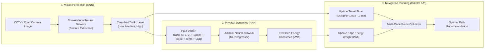

# Traffic Image Classification (CNN) Integration Guide

## 1. How CNN and ANN Work Together in this Project



### The Synergy Between CNN and ANN:
1. **CNN (Computer Vision & Perception Layer)**:
   - Processes **unstructured visual data** (pixels from traffic monitoring cameras or satellite feeds).
   - Detects vehicle density, lane occupancy, and congestion patterns.
   - Categorizes the road segment into **Low (0)**, **Medium (1)**, or **High (2)** traffic density.

2. **ANN (Physical Energy Prediction Layer)**:
   - Takes the **structured traffic encoding** from the CNN alongside physical parameters (distance, speed limit, road slope/elevation, vehicle payload, temperature).
   - Models the non-linear battery consumption penalties of stop-and-go acceleration and prolonged auxiliary HVAC drain.
   - Accurately predicts the energy required in **kilowatt-hours (kWh)**.

3. **Graph Search Engine (Decision Layer)**:
   - Applies the CNN-derived traffic delays and ANN-predicted energy consumption as edge weights in the **NetworkX** city graph.
   - Uses **Dijkstra** or **A\*** search to re-route electric vehicles around sudden traffic jams, maximizing battery range.

---

## 2. Recommended Public Traffic Image Datasets

To train the CNN on real-world road camera images, download any of these open datasets:

1. **Kaggle - Traffic Congestion Image Dataset**:
   - Contains thousands of labeled urban intersection camera images categorized into `Low`, `Medium`, and `High` congestion.
   - URL: [Kaggle Traffic Congestion Dataset](https://www.kaggle.com/datasets) (Search: `traffic-congestion-images` or `vehicle-density-classification`).

2. **UCSD Traffic Dataset**:
   - Video and frame captures of highway traffic under various weather and lighting conditions categorized by traffic density (light, medium, heavy).
   - URL: [UCSD Traffic Dataset](http://vision.ucsd.edu/content/traffic-dataset)

3. **Roboflow Traffic Flow & Density Datasets**:
   - Pre-labeled road camera frames ready for image classification.
   - URL: [Roboflow Universe Traffic Projects](https://universe.roboflow.com/)

---

## 3. Dataset Directory Structure

Place downloaded images into the following folder hierarchy inside `data/traffic_images/`:

```text
data/traffic_images/
├── train/
│   ├── low/       # 500+ images of free-flowing roads
│   ├── medium/    # 500+ images of moderate traffic
│   └── high/      # 500+ images of heavy congestion / bumper-to-bumper
├── val/
│   ├── low/       # 100+ validation images
│   ├── medium/    # 100+ validation images
│   └── high/      # 100+ validation images
├── sample_low.png       # Built-in synthetic test image
├── sample_medium.png    # Built-in synthetic test image
└── sample_high.png      # Built-in synthetic test image
```

---

## 4. CNN Architecture Specification

When TensorFlow/Keras is installed, the model is built with:

```python
from tensorflow import keras
from tensorflow.keras import layers

model = keras.Sequential([
    layers.Input(shape=(128, 128, 3)),
    layers.Conv2D(32, (3, 3), activation="relu"),
    layers.MaxPooling2D((2, 2)),
    layers.Conv2D(64, (3, 3), activation="relu"),
    layers.MaxPooling2D((2, 2)),
    layers.Conv2D(128, (3, 3), activation="relu"),
    layers.MaxPooling2D((2, 2)),
    layers.Flatten(),
    layers.Dense(128, activation="relu"),
    layers.Dropout(0.3),
    layers.Dense(3, activation="softmax")
])

model.compile(optimizer="adam", loss="categorical_crossentropy", metrics=["accuracy"])
```

---

## 5. Training the Model

Once images are placed in the dataset directory:

```python
from tensorflow.keras.preprocessing.image import ImageDataGenerator

train_gen = ImageDataGenerator(rescale=1./255, horizontal_flip=True).flow_from_directory(
    "data/traffic_images/train", target_size=(128, 128), batch_size=32, class_mode="categorical"
)

val_gen = ImageDataGenerator(rescale=1./255).flow_from_directory(
    "data/traffic_images/val", target_size=(128, 128), batch_size=32, class_mode="categorical"
)

history = model.fit(train_gen, validation_data=val_gen, epochs=20)
model.save("models/cnn_traffic_model.keras")
```

---

## 6. Real-Time Inference & Graph Weight Translation

The function `predict_traffic_from_image(image_path)` returns:
- `traffic_level`: `"low"`, `"medium"`, or `"high"`
- `traffic_level_encoded`: `0`, `1`, or `2`
- `confidence`: Probability score ($0.0$ to $1.0$)

The predicted category translates to graph edge multipliers:
- **Low**: Time $\times 1.00$, Speed Factor $= 1.00$, Stop-and-go energy penalty $= +0\%$
- **Medium**: Time $\times 1.25$, Speed Factor $= 0.80$, Stop-and-go energy penalty $= +14\%$
- **High**: Time $\times 1.65$, Speed Factor $= 0.55$, Stop-and-go energy penalty $= +30\%$

This updates edge travel time and triggers the ANN to re-calculate battery consumption for the affected road segment.
